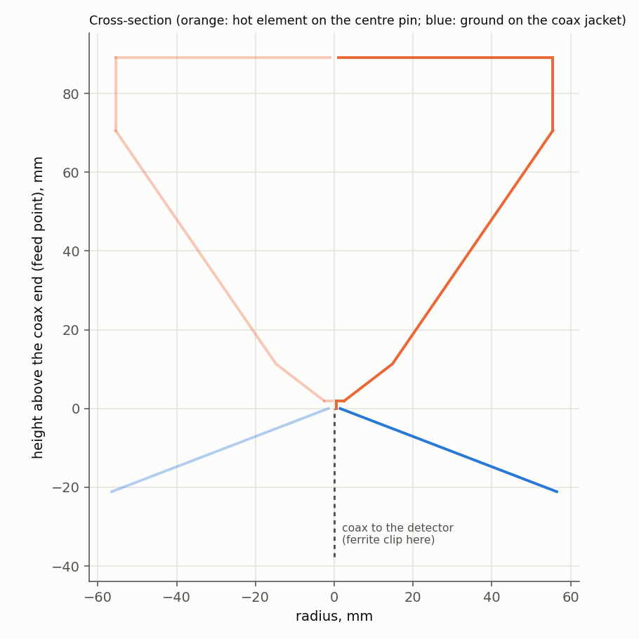
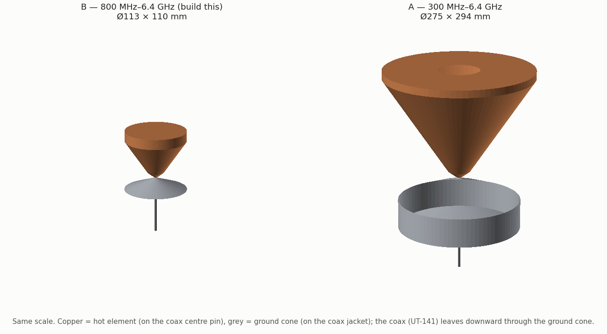
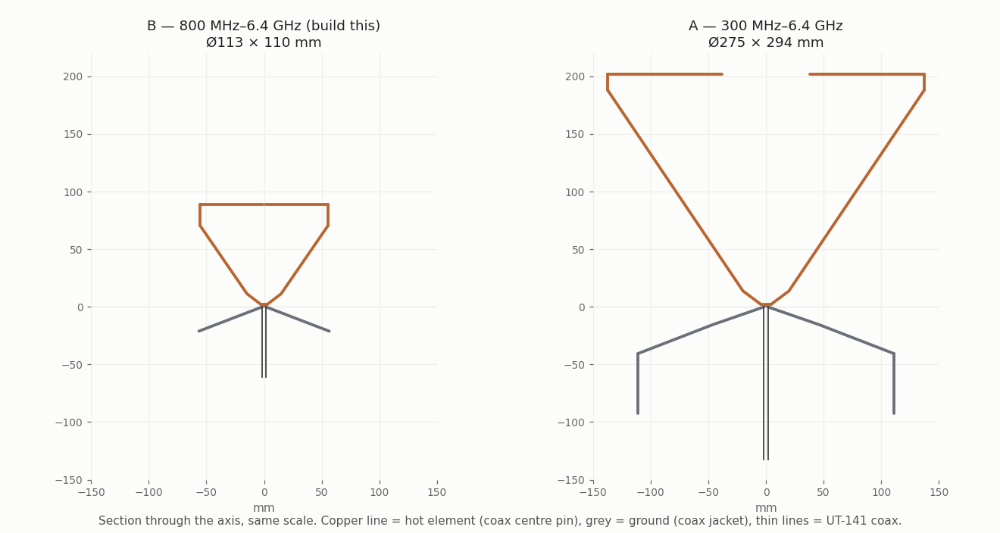
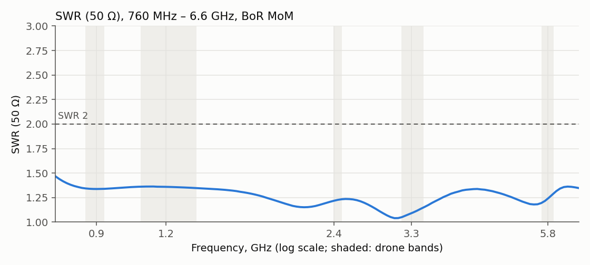
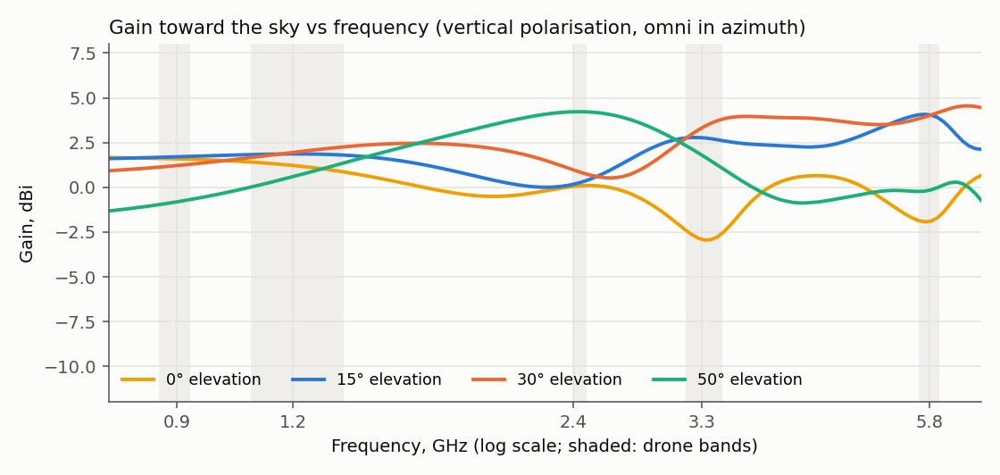
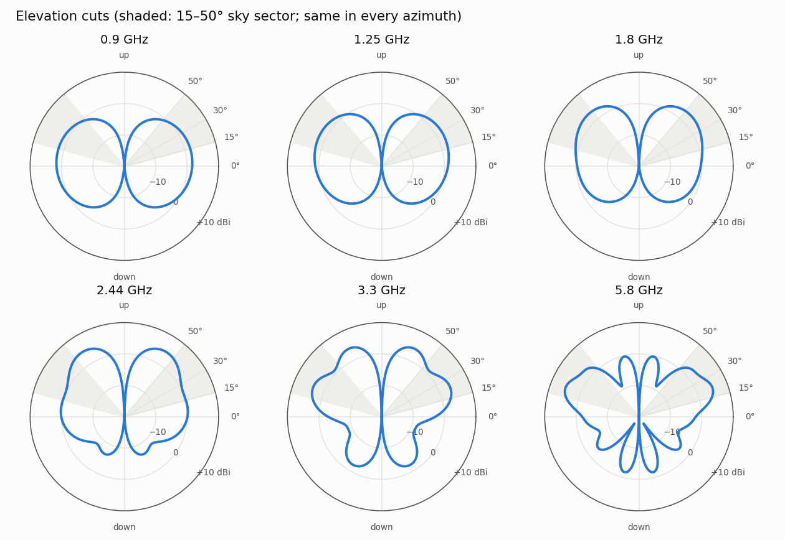
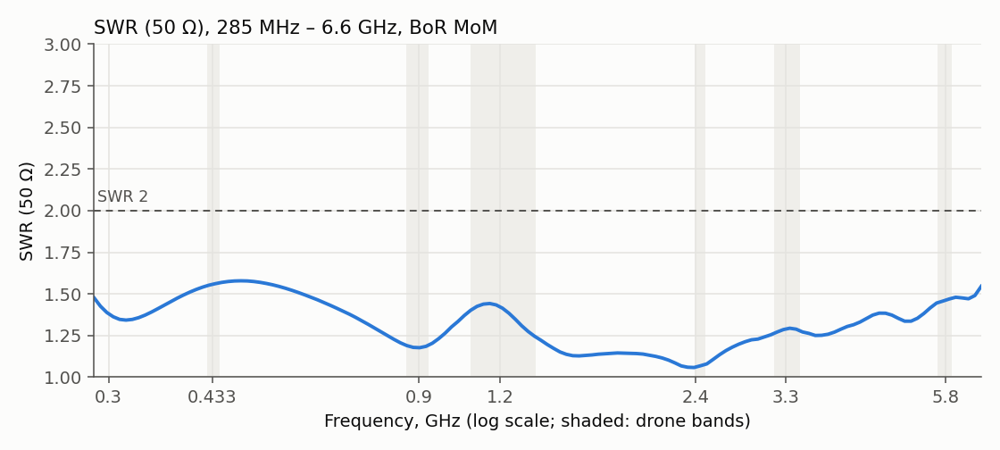
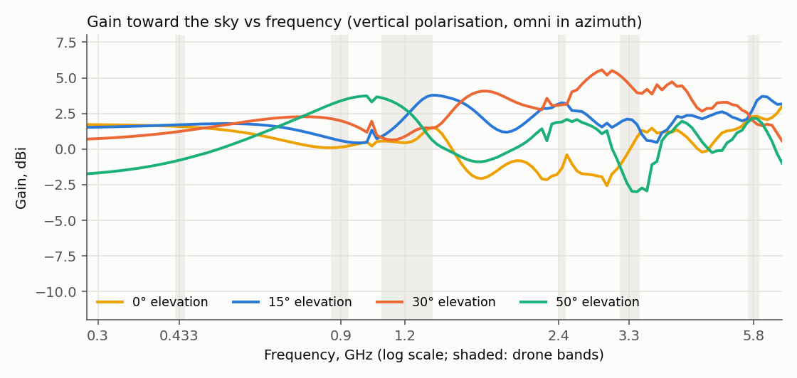

# Wideband omni antenna for a handheld FPV / drone detector (800 MHz – 6.4 GHz)

A simulation study: the antenna has been designed and checked with two independent solvers, but
**not yet built and measured**. Everything needed to build it, to check it with a VNA, and to repeat
or extend the search is here and in [`tools/wideband-antenna/`](../tools/wideband-antenna/README.md).

**Recommended design (B): a sky-tilted cone antenna, Ø113 × 110 mm.** A hot cone with a closed lid
sits on the coax centre pin and opens upward; a shallow ground cone is soldered to the coax jacket
underneath it. Fed by 0.141″ semi-rigid / hand-formable coax.

| | Design B (recommended) |
|---|---|
| Band | 800 MHz – 6.4 GHz (8:1): 868/915 MHz control, 1.2–1.3, 2.4, 3.3, 5.8 GHz video |
| SWR (50 Ω) | ≤ 1.38 over the whole band (MoM, no cable); with 15 cm of cable and no ferrite ≤ 1.75 (MoM) / 1.71 (independent FDTD) |
| Gain toward the sky, 15–50° elevation | average +2.3 dBi, never below −1.2 dBi at any frequency |
| Pattern | omni in azimuth (rotationally symmetric), vertical polarisation; peak 1.7–5 dBi at 10–56° elevation |
| Size | Ø113 mm × 110 mm; ≈ 75 g of 0.2 mm brass (hot element ≈ 55 g) |
| Build tolerance | lengths ±1 mm, gap ±0.3 mm, angles ±1.5°: 48 of 48 random builds SWR < 2 (worst 1.77) |
| Feed cable | ferrite on the cable under the ground cone recommended: then SWR ≤ 1.61 with any cable length; without it ≤ 1.75 except a 10 cm cable (2.15 at 800 MHz) |

A larger variant **A** (Ø275 × 294 mm) covers **300 MHz – 6.4 GHz** (433 MHz too) with SWR ≤ 1.58 (≤ 1.76 with 35 cm of cable, MoM and FDTD; needs a ferrite);
see [Variant A](#variant-a-full-range-300-mhz--64-ghz).
A compact variant **S73** (Ø73 × 71 mm) covers **960 MHz – 6.4 GHz** with SWR ≤ 1.97 (≤ 1.80 with any cable; needs a 6-bead ferrite sleeve; FDTD with the plastic kit ≤ 2.00);
see [Smaller: compact variants](#smaller-compact-variants-from-960-mhz).







**In the app:** the designs are antenna types in the Broadband group, **"Sky-tilted capped bicone (8:1)"** (B),
**"(21:1)"** (A) and **"compact (6.7:1)"** (S73). The band editor scales the shape (e.g. 1–8 GHz); Simulation shows this study's
tabulated MoM sweep and elevation pattern, scaled to the size; Build lists the flat patterns and
prints them at 1:1 (`src/lib/antennas/skycone.ts`). The name: an *asymmetric bicone*, or an *inverted
discone* (cone on top as the hot element, a shallow ground cone below), with a capped top (rim + lid).

## Requirements

| Item | Target | Notes |
|---|---|---|
| Band | 800 MHz – 6.4 GHz | (first asked as 300 MHz – 6.4 GHz; variant A meets that) |
| Match | SWR ≤ 2 (50 Ω) over the whole band | designed for ≤ 1.85 in MoM, margin for model error and build tolerance |
| Pattern | omni in azimuth, like a cloverleaf on a coax stick; good gain at **15–50° elevation** | the detector is held upright; drones are in the air |
| Size | ≤ 300 mm height and diameter | handheld; the 800 MHz design needs only 113 mm |
| Polarisation | linear (vertical) accepted | CP drone signals arrive 3 dB down, fine for detection |

## Starting point: why a cloverleaf cannot do it

App MoM (`src/lib/mom.ts`), log sweeps; the discone rows use the new body-of-revolution solver.

| Candidate | Result |
|---|---|
| **Cloverleaf** (app default: 3 leaves, 45°, Ø1 mm, 5.8 GHz) | SWR < 2 only from 5.1 to 6.8 GHz; 6.7 at 4 GHz, 22 at 3.2 GHz, > 100 below 2 GHz. A cloverleaf is a set of resonant loops: scaling or bending them moves a ~30 % window, it never makes it 8:1. |
| **Discone, app builder** (16 rods Ø3 mm, slant 310 mm) | SWR < 2 only up to ~700 MHz, 1.8–3.7 above. 16 rods stop acting as a cone above ~1 GHz. Above 1 GHz the beam goes **down** (toward the cone): −3 … −28 dBi at 15–50° elevation. |
| **Solid discone** (sheet metal) | SWR ≤ 2 over a decade, but the beam points 40° **below** the horizon above 1.3 GHz (−5 … −22 dBi toward the sky). |
| **Same, upside down** (hot cone on top, ground disc below) | the beam tilts **up** to +35…+50° at high frequencies — the 15–50° window. But a small ground disc drives current onto the feed cable: with 300 mm of cable the SWR went to 9.9 at the bottom of the band. |

What shaped the design:

1. A wide band needs a shape defined by **angles** (cones) made of **solid sheet**, not resonant wires.
2. A discone/bicone beam tilts toward its **narrower** element at high frequencies. Hot cone on top +
   wide ground below = beam tilted to the sky.
3. At the bottom of the band a small antenna drives current onto its feed cable; the cable is part of
   the antenna unless a ferrite (or a sleeve) stops it. Every candidate was scored with cables.
4. Above 3 GHz everything is decided within ~10 mm of the feed: pin gap, the washer on the pin and the
   ground around the coax. A flat 13 mm SMA flange at the apex raised the 6 GHz SWR from 2 to 3.3, so
   the feed is a 0.141″ semi-rigid coax with the ground cone soldered to its jacket.

## Design B: dimensions

z = 0 is the cut end of the coax (outer conductor and PTFE cut flush); the centre conductor continues
upward. All sheet parts are cones, cylinders or discs; flat patterns are annular sectors: draw two
arcs of radius R_in and R_out, keep the given sector angle, add a 4–5 mm overlap tab on one straight
edge, roll until the straight edges meet and solder the seam.

| Part | Shape | Flat pattern |
|---|---|---|
| Feed | 0.141″ semi-rigid or hand-formable coax (UT-141, RG-402: centre Ø0.92 mm, PTFE Ø2.98 mm, jacket Ø3.58 mm), cut flush at z = 0 | an SMA–SMA .141 jumper cut in half gives the cable and the connector |
| Ground cone | apex on the jacket at z = 0, opens **down**, half-angle **69.0°** (21° below horizontal), Ø3.6 → **Ø113.0 mm**, depth 21.1 mm, slant 58.9 mm | sector R 1.6–60.5 mm, **336.1°** (cut out a 23.9° wedge); drill the apex for the jacket |
| Washer (hot) | brass disc **Ø5.0 mm**, Ø1 mm hole, soldered on the centre pin with its underside **1.9 mm** above the coax end | — |
| Feed cone (hot) | from the washer edge, opens **up**, half-angle **52.5°**, Ø5.0 → **Ø29.6 mm**, height 9.4 mm, slant 15.5 mm | sector R 3.2–18.7 mm, **285.6°** |
| Main cone (hot) | half-angle **34.5°**, Ø29.6 → **Ø111.0 mm**, height 59.2 mm, slant 71.9 mm | sector R 26.1–98.0 mm, **203.9°** |
| Rim (hot) | cylinder **Ø111.0 × 18.5 mm** | strip 348.7 × 18.5 mm |
| Lid (hot) | flat disc **Ø111.0 mm** closing the top at z = 89.1 mm | disc |

Overall: Ø113.0 mm, from z = −21.1 mm (ground rim) to z = +89.1 mm (lid), 110.2 mm tall.

Parameters (metres, degrees) for the tools: [`tools/wideband-antenna/designs/B_simple.json`](../tools/wideband-antenna/designs/B_simple.json).
The optimiser's original shape (two-angle ground, a Ø9 mm hole in the lid, a 2.5 mm skirt) is
`B.json`; simplifying it changed the worst SWR from 1.42 to 1.38 and the sky gain by < 0.3 dB.

## Design B: simulated performance







Drone bands (MoM, λ/24 mesh, no cable; gain in dBi, averaged over 5 points per band):

| Band, GHz | Max SWR | 0° | 15° | 30° | 50° | Peak (elevation) |
|---|---|---|---|---|---|---|
| 0.86–0.93 | 1.34 | 1.6 | 1.7 | 1.2 | −0.8 | 1.7 (11°) |
| 1.08–1.36 | 1.36 | 1.2 | 1.8 | 2.0 | 0.7 | 2.0 (25°) |
| 2.40–2.48 | 1.23 | 0.1 | 0.3 | 0.9 | 4.2 | 4.6 (56°) |
| 3.17–3.47 | 1.15 | −2.7 | 2.7 | 3.3 | 1.7 | 4.1 (48°) |
| 5.65–5.95 | 1.30 | −1.8 | 4.0 | 4.0 | −0.1 | 5.1 (22°) |

Over the whole band: worst SWR 1.38 (at 809 MHz); gain over 15–50° elevation averages +2.3 dBi and
never drops below −1.2 dBi. Below the horizon the gain falls off (the ground cone and the hand are
there), which is what a sky-watching detector wants. Full sweep:
[`results/B_simple_sweep.csv`](../tools/wideband-antenna/results/B_simple_sweep.csv).

### Feed cable and ferrite

Worst SWR over 800 MHz – 3.2 GHz with a coax hanging below the antenna (the cable's outer surface is
part of the antenna). Ferrite = a 150 Ω series loss on the cable 10 mm below the ground cone.

| Cable below the antenna | 5 cm | 10 cm | 15 cm | 20 cm | 35 cm | 50 cm | 100 cm |
|---|---|---|---|---|---|---|---|
| no ferrite | 1.74 | 2.15 | 1.71 | 1.56 | 1.68 | 1.75 | 1.61 |
| with ferrite | 1.35 | 1.39 | 1.58 | 1.56 | 1.61 | 1.50 | 1.48 |

Put one or two ferrite beads (material 61 or 43, inner Ø ≥ 3.7 mm) on the coax right under the
ground cone. Without them the antenna still works with most cables, but a 10 cm cable resonates at
the bottom of the band. In real use the detector box and the hand are the "cable": the ferrite makes
the antenna independent of them.

### Build tolerance

Monte Carlo, 48 random builds each, every dimension perturbed independently (uniform):

| Tolerance | Builds with SWR < 2 | Median worst SWR | 90th percentile | Worst |
|---|---|---|---|---|
| lengths ±1 mm, pin gap ±0.3 mm, angles ±1.5° | 100 % | 1.41 | 1.59 | 1.77 |
| lengths ±2 mm, pin gap ±0.5 mm, angles ±3° | 92 % | 1.47 | 1.81 | 2.21 |

One at a time (worst SWR in 0.8–1.5 / 1.5–4 / 4–6.4 GHz; nominal 1.40 / 1.33 / 1.36):

| Change | 0.8–1.5 GHz | 1.5–4 GHz | 4–6.4 GHz |
|---|---|---|---|
| pin gap −0.5 mm / +0.5 mm | 1.34 / 1.46 | 1.33 / 1.49 | **1.11 / 1.67** |
| washer Ø −2 mm / +2 mm | 1.46 / 1.37 | 1.43 / 1.27 | **1.60 / 1.26** |
| main cone angle −3° / +3° | 1.34 / **1.55** | 1.29 / 1.39 | 1.33 / 1.40 |
| feed cone angle −3° / +3° | 1.44 / 1.40 | 1.39 / 1.32 | 1.32 / 1.40 |
| ground angle −3° / +3° | 1.45 / 1.43 | 1.40 / 1.29 | 1.38 / 1.34 |
| hot / ground diameter ±4 mm, rim ±2 mm | ≤ 1.45 | ≤ 1.35 | ≤ 1.40 |

The pin gap and the washer set the top of the band; the main cone angle sets the bottom. Everything
else is forgiving.

## How to build design B

### Materials

- 0.2–0.3 mm brass or copper sheet (or tin-plate from food cans: it solders well). About 300 × 200 mm.
  Aluminium works electrically but cannot be soldered; copper foil tape with **conductive** adhesive
  on a 3D-printed or card former also works if every seam is soldered.
- 0.141″ (3.58 mm) semi-rigid or hand-formable coax, 50 Ω, PTFE — e.g. one half of an
  SMA-male–SMA-male .141 jumper, 15–30 cm. RG-402 / UT-141 / "hand-formable .141" all match the model.
- One or two ferrite beads, material 61 or 43, inner Ø ≥ 3.7 mm, to slide on the coax.
- For the holder: PETG or PLA (3D-printed cover) or rigid foam (EPS/XPS, any shape, electrically invisible).

### Steps

**Full step-by-step guide with 3D-printed templates, formers, soldering jigs, cover and cup:
[FPV-DETECTOR-BUILD.md](FPV-DETECTOR-BUILD.md).** In short:

1. Cut the flat patterns (printed templates or the app's 1:1 PDF), roll the cones on the printed
   former and in the cup's cradle, and solder the seams.
2. Thread the coax through the handle and cup, cut its end flush, solder the ground cone apex to the
   jacket (coax end flush with the inside of the apex).
3. Solder washer + feed cone to the centre pin on the **1.9 mm** gap fork.
4. Rest the main cone + rim on three printed wedges, solder it to the feed cone, then the lid.
5. Measure, remove the wedges, glue the cover to the lid and the cup. The ferrite sits in the handle.

### Plastic cover or holder

FDTD, design B with 15 cm of cable, bare vs a 1.2 mm PETG (εr 2.6) cover: a cylinder Ø117 mm
(2 mm outside the ground rim) from the ground rim to just above the lid, closed by a 1.2 mm top that
rests on the lid.

| | Bare | With cover |
|---|---|---|
| Max SWR 800 MHz – 6.4 GHz | 1.71 | 1.72 |
| Largest change | — | 3.7–4.2 GHz: 1.28 → 1.43 |
| Patterns at 0.9 / 1.25 / 2.44 / 3.3 / 5.8 GHz | — | within 1.1 dB |

So a printed cup that clips onto the ground rim and is glued to the lid is fine. Rigid foam
(εr ≈ 1.05) is even less visible. Keep plastic out of the feed region (the first ~15 mm around the
coax end): the pin gap is the most sensitive dimension and a plastic plug there was not simulated.

### Checking it with a VNA

- Calibrate at the SMA end of the coax (or include the coax: the PTFE coax loss is ~1 dB/m at 6 GHz
  and only improves the reading).
- Expect S11 below about −13 dB (SWR 1.6) over most of the band and below −10 dB (SWR 2) everywhere
  from 800 MHz to 6.4 GHz; the model without cable is −16 dB or better everywhere. Compare with
  [`results/B_simple.s1p`](../tools/wideband-antenna/results/B_simple.s1p) — the app's Simulation tab
  imports `.s1p` for the measured-vs-model view.
- Hold it the way it will be used (on the detector, in the hand) for the final check.
- **Too high at 4–6.4 GHz:** the pin gap is the knob — reduce it (−0.5 mm took the top-band SWR from
  1.36 to 1.11), or the washer is too small / off-centre. **Too high near 800 MHz:** check the main
  cone angle and that the lid and rim are soldered all round; add the ferrite. A resonance that moves
  when you touch the cable means the ferrite is missing or too far down.

## Variant A: full range 300 MHz – 6.4 GHz

The same topology optimised for the first requirement (300 MHz – 6.4 GHz, ≤ 300 mm). Use it only if
433 MHz matters: it is 2.5× larger.

| | Design A |
|---|---|
| Band | 300 MHz – 6.4 GHz (21:1), including 433 MHz |
| SWR (50 Ω) | ≤ 1.58 (MoM, no cable, worst at 480 MHz); with 35 cm of cable ≤ 1.76 in both MoM and the independent FDTD |
| Gain toward the sky, 15–50° elevation | average +2.2 dBi, lowest −3.0 dBi |
| Size | Ø275 × 294 mm (hot element Ø274.7, ground Ø222.1 with a 51.9 mm skirt) |
| Feed cable | **ferrite required**: with it SWR ≤ 1.66 for any cable length; without it a 15 cm cable gives 4.5 and 20 cm 2.4 at the bottom of the band |

| Band | SWR | Gain 0 / 15 / 30 / 50° (dBi) | Peak |
|---|---|---|---|
| 433 MHz | 1.57 | 1.6 / 1.7 / 1.2 / −0.8 | 1.7 dBi @ 11° |
| 868/915 MHz | 1.19 | 0.1 / 0.6 / 2.0 / 3.4 | 3.4 dBi @ 49° |
| 1.2 GHz | 1.44 | 0.8 / 2.4 / 1.1 / 2.3 | 3.6 dBi @ 41° |
| 2.4 GHz | 1.08 | −1.3 / 3.2 / 3.1 / 1.9 | 4.0 dBi @ 22° |
| 3.3 GHz | 1.29 | 0.0 / 1.9 / 4.5 / −2.4 | 4.8 dBi @ 32° |
| 5.8 GHz | 1.48 | 2.2 / 2.9 / 2.0 / 2.1 | 4.0 dBi @ 11° |

Cut list (z = 0 at the coax end; flat patterns as for B):

| Part | Shape | Flat pattern |
|---|---|---|
| Washer (pin) | flat annulus Ø0.9 → Ø9.5 mm at z = 2.4 mm | disc Ø9.5, hole Ø0.9 |
| Hot feed cone | 53.2°, Ø9.5 → Ø39.9 mm, height 11.3 mm | sector R 6.0 – 24.9 mm, 288.4° |
| Hot main cone | 33.9°, Ø39.9 → Ø274.7 mm, height 174.4 mm | sector R 35.7 – 245.9 mm, 201.0° |
| Rim | cylinder Ø274.7 × 13.6 mm | strip 862.9 × 13.6 mm |
| Lid ring | flat annulus Ø76.6 → Ø274.7 mm at z = 201.7 mm | ring Ø274.7, hole Ø76.6 |
| Ground inner cone | 70.9°, Ø3.0 → Ø93.1 mm, height 15.6 mm | sector R 1.6 – 49.3 mm, 340.1° |
| Ground outer cone | 68.8°, Ø93.1 → Ø222.1 mm, height 25.0 mm | sector R 49.9 – 119.1 mm, 335.7° |
| Ground skirt | cylinder Ø222.1 × 51.9 mm | strip 697.6 × 51.9 mm |

FDTD check (35 cm cable): SWR ≤ 1.76 from 300 MHz to 6.4 GHz, identical to MoM at the bottom
(300 MHz: 1.76 both) and within 0.2 at the top; patterns agree within 0.5 dB except 5.8 GHz at 30°
(0.4 vs 1.9 dBi, a deep null region). Design file: `tools/wideband-antenna/designs/A.json`; in the
app: "Sky-tilted capped bicone (21:1)".





## Smaller: compact variants from 960 MHz

The size is set by the lowest frequency (the shape scales with 1/f_low) and, once the antenna gets
small, by the feed cable: the shorter ground cone hands more of the bottom-band current to the coax
shield, and a single bead no longer stops it (a 15–35 cm cable resonates by itself past one bead).
A **ferrite sleeve** — about 6 beads (material 43/61, inner Ø ≥ 3.7 mm) stacked on the first ~11 cm
of coax under the ground cone, inside the handle — fixes that. Model: 6 × 150 Ω series loss at
1, 3 … 11 cm. Over 960 MHz – 6.4 GHz (MoM, worst SWR over cables of 5 cm – 1 m):

| Design | Size | SWR, no cable | Cable, no ferrite | 1 bead | 6-bead sleeve | Gain 15–50°: avg / worst freq |
|---|---|---|---|---|---|---|
| B rescaled to 960 MHz | Ø94 × 92 mm | 1.38 | — | 1.66 | 1.35 | +2.1 / +0.7 dBi |
| B × 0.75 | Ø85 × 82 mm | 1.59 | — | 2.12 | 1.58 | +1.9 / +0.5 dBi |
| **B × 0.708** | **Ø80 × 78 mm** | 1.81 | 4.87 | 2.57 | **1.79** | +1.9 / +0.5 dBi |
| **S73** (re-optimised, ≤ 75 mm, built simplified) | **Ø73 × 71 mm** | 1.97 | 7.94 | 2.93 | **1.80** | +1.8 / +0.4 dBi |
| S68 (re-optimised, ≤ 68 mm) | Ø68 × 67 mm | 2.36 | 8.77 | 3.29 | 2.38 | +1.7 / +0.3 dBi |

- Rescaling alone gets to Ø80 mm with SWR ≤ 2; re-optimising the shape buys ~7 mm more (S73).
  Below ~70 mm the bottom of the band goes over SWR 2 whatever the shape.
- The pattern barely changes (only the lowest frequencies get electrically small); sky gain drops
  by ~0.3 dB.
- Receive-only: mismatch loss is 0.5 dB at SWR 2, 0.9 dB at 2.5, 1.25 dB at 3, so S68 (or B × 0.6,
  Ø68 mm, SWR 2.8–3.1) still works for a detector at ~1 dB cost near 1 GHz.
- **The ferrite sleeve is mandatory** for every compact variant: without ferrite a 10 cm cable gives
  SWR 5–9 at 960 MHz.
- S73 straight out of the optimiser had a Ø14 mm hole in the lid and a 1.1 mm skirt; the built
  version closes the lid and drops the skirt (`designs/S73.json`; the raw result is `S73_raw.json`).
  No-cable SWR 1.92 → 1.97, with the sleeve 1.84 → 1.80.
- In the app: **"Sky-tilted capped bicone, compact (6.7:1)"** (Simulation = this table, Build = cut
  list, 1:1 templates, the 6 beads in the BOM and the printed kit with a 130 mm handle whose pocket
  holds the sleeve). "Sky-tilted capped bicone (8:1)" with the band `960e6-6400e6` is the Ø94 × 92 mm
  rescale.

### Design S73: cut list and checks

z = 0 at the coax end; top z = 57.8 mm, bottom z = −13.2 mm.

| Part | Shape | Flat pattern |
|---|---|---|
| Washer (pin) | flat annulus Ø0.9 → Ø5.6 mm at z = 2.65 mm | disc Ø5.6, hole Ø0.9 |
| Hot feed cone | 38.1°, Ø5.6 → Ø20.3 mm, height 9.4 mm | sector R 4.5 – 16.4 mm, 222.4° |
| Hot main cone | 31.3°, Ø20.3 → Ø73.1 mm, height 43.4 mm | sector R 19.5 – 70.3 mm, 187.0° |
| Rim | cylinder Ø73.1 × 2.4 mm | strip 229.6 × 2.4 mm |
| Lid | flat disc Ø73.1 mm at z = 57.8 mm | disc Ø73.1 (Ø2 centring hole) |
| Ground inner cone | 67.3°, Ø3.0 → Ø19.0 mm, height 3.4 mm | sector R 1.6 – 10.3 mm, 332.1° |
| Ground outer cone | 69.3°, Ø19.0 → Ø70.9 mm, height 9.8 mm | sector R 10.2 – 37.9 mm, 336.7° |

The pin gap (2.65 mm) is again the top-of-band knob. Build it like B
([FPV-DETECTOR-BUILD.md](FPV-DETECTOR-BUILD.md)) with the parts from the app, and put the 6 beads
on the coax before it goes through the handle.

FDTD check (independent axisymmetric solver, 3 cm of cable; the FDTD has no ferrite model, so the
short cable stands in for the sleeve), `results/fdtd_S73_*cable3cm.txt`:

| | Bare | Cover + solid cup + 130 mm handle (PETG) |
|---|---|---|
| Worst SWR, 960 MHz – 6.4 GHz (FDTD) | 1.91 (MoM 1.90) | 2.00 |
| Patterns vs MoM / vs bare | within 0.3 dB | within 0.5 dB at 15–30°; 5.8 GHz at 50°: −1.8 dB |

The 2.00 is a narrow feature at 1.6–1.8 GHz that comes from the short cable (MoM shows it too, and it
is absent without a cable); elsewhere the plastic moves the SWR by ≤ 0.2 (top of the band
1.60 → 1.79). The cover sits 2 mm outside the rim, as for B, which is relatively closer on this
smaller antenna.

## How it was found

Tools: [`tools/wideband-antenna/`](../tools/wideband-antenna/README.md) (Python + numba; the README
has the step-by-step workflow). The app's thin-wire MoM cannot model solid cones up to 6.4 GHz (a wire
grid fine enough would need ~10 000 unknowns), so two solvers for **bodies of revolution** were
written for this search:

- **BoR MoM** (`bor.py`): EFIE for PEC surfaces of revolution, axisymmetric (m = 0) current, exact ring
  kernel (static part via the complete elliptic integral, log singularity integrated analytically).
  Design B at 6.4 GHz is ~90 unknowns; a 26-point sweep plus the cable cases takes ~3 s, so a global
  optimiser can afford thousands of designs. Coax feed = TEM "frill" on the aperture annulus between
  the centre conductor (Ø0.92 mm) and the PTFE (Ø2.98 mm). Lumped loads model the ferrite.
- **BoR FDTD** (`fdtd_bor.py`): a different method used only for checking — graded Yee grid, CPML,
  staircased metal, the coax modelled physically (PTFE, soft TEM source, matched termination,
  de-embedded to the coax end), dielectric shells (cover), near-to-far-field box for patterns.

Search: differential evolution (8 processes) over a shape family — hot element = washer on the pin +
two cone angles + cylinder + top cap; ground = two cone angles + skirt; everything inside a size
budget. Each design is scored on

- 26 log-spaced frequencies 760 MHz – 6.6 GHz (5 % margin at both ends), no cable;
- 760 MHz – 2 GHz with 10, 20 and 35 cm of cable plus a 150 Ω ferrite, and 15 and 35 cm without;
- **max SWR, floored at 1.85, + sky-gain deficit**: below SWR 1.85 the optimiser gets nothing for a
  better match and works on gain at 15, 20 … 50° elevation (target average ≥ +1 dBi, worst ≥ −2 dBi).
  A first run without the floor found SWR ≤ 1.67 designs whose beam pointed 10–20° *down* above
  1.3 GHz (−3 … −6 dBi at 35–50°), so the pattern has to be in the score.

History: run 1 (300 MHz, SMA-sized feed, one-angle cones) → run 2 (two-angle cones, UT-141 feed, sky
score) gave **A**; for 800 MHz, design A scaled by ⅜ was the seed of run 4 (≤ 120 mm), which gave
**B** within 6 generations. A short run at ≤ 95 mm stayed at SWR ≈ 3 (λ/4 at 800 MHz is 94 mm:
~110 mm is the practical minimum for this pattern and margin).

Run 6 then made the cable a hard requirement **without** a ferrite (5, 10, 15, 25 and 40 cm, ≤ 120 mm):
it found **design C** (`designs/C.json`, Ø114 × 118 mm, a two-angle ground cone with a 26 mm skirt):
SWR ≤ 1.61 without cable and ≤ 1.70 with any cable from 5 cm to 1 m, ferrite or not. The price is the
pattern: the gain at 50° elevation drops to about −2.5 dBi below 2 GHz and −3.4 dBi at 2.4 GHz (B:
−0.8 and +4.2), and the 2.6–4 GHz beam sits at 0–10°. B with a clip-on ferrite stays the
recommendation; C is the fallback if a ferrite really cannot be fitted (not FDTD-checked).

### Solver validation

| Check | Result |
|---|---|
| Ring kernel vs adaptive quadrature (I₀, I₀ − I₁; 6 cases incl. near-singular at 6.4 GHz) | 4–6 digits; worst 0.4 % (near-singular real part) |
| Analytic log-singular integrals vs quadrature | 15 digits |
| Tube dipole Ø2 × 500 mm vs NEC-2 (nec2++, 101 segments) | 250 MHz 45.9 − j112.8 vs 47.8 − j109.4 Ω; 280 MHz 66.7 − j19.0 vs 68.4 − j13.7 Ω; 300 MHz 85.9 + j44.2 vs 86.8 + j49.9 Ω; gain 2.04 / 2.12 / 2.18 dBi in both |
| Far-field-integrated power / input power (MoM) | 1.0000 on every case |
| Mesh convergence (12 → 40 segments/λ, feed cells 0.3 → 0.1 mm) | Z moves ≤ 2 Ω at 0.3–6.4 GHz, gain ≤ 0.1 dB |
| FDTD vs MoM, design B (as optimised) + 15 cm cable, 36 frequencies 0.76–6.4 GHz | SWR within 0.01–0.09 everywhere; FDTD ≤ 1.59 in band (MoM ≤ 1.62) |
| FDTD vs MoM patterns, design B, 0.9 / 1.25 / 2.44 / 3.3 / 5.8 GHz, 0–70° elevation | within 0.1–0.8 dB; FDTD P_rad/P_acc 0.993–1.003 |
| FDTD vs MoM, design A + 35 cm cable, 0.3–6.4 GHz | SWR within 0.2; FDTD ≤ 1.76 |
| FDTD vs MoM patterns, design A, 0.43–5.8 GHz | within 0–1.5 dB |

The two solvers share no code and differ in feed model (frill vs physical coax) and geometry
(exact vs staircased), so agreement to ~0.1 in SWR is a strong check of the numbers above.

## Limitations

- Not built or measured yet. Simulated: perfect conductors, no hand, no detector box (the cable cases
  and the ferrite bound that), no solder blobs.
- The cover/holder is modelled as a uniform PETG shell (εr 2.6); other plastics shift the result a
  little (see the cover section).
- Vertical polarisation only: a drone antenna lying horizontally is seen 10–20 dB down near the
  horizon. CP video links (cloverleaf/pagoda on the drone) arrive 3 dB down.
- Gain below the horizon is low by design; a detector pointed at a drone *below* the operator
  (hills, rooftops) loses ~5 dB.

## Reproduce or extend

See [`tools/wideband-antenna/README.md`](../tools/wideband-antenna/README.md): set-up, every script,
the workflow (baseline → validate → model the cable → satisfice-then-optimise → verify) and the
lessons. To redo this design for another band or size:

```bash
cd tools/wideband-antenna
SIZE=0.12 FAMILY=family6 X0=designs/B_simple.json .venv/bin/python opt.py myrun 30 1   # edit FS_MAIN/FS_LOW in family6.py for the band
.venv/bin/python report.py family6 "$(cat designs/B_simple.json)" 16 34 800e6
F_LO=800e6 .venv/bin/python tolerance.py family6 "$(cat designs/B_simple.json)" 48 1 0.3 1.5
F_LO=760e6 MARGIN=0.15 .venv/bin/python fdtd_verify.py family6 designs/B_simple.json 0.15 out.json
```
