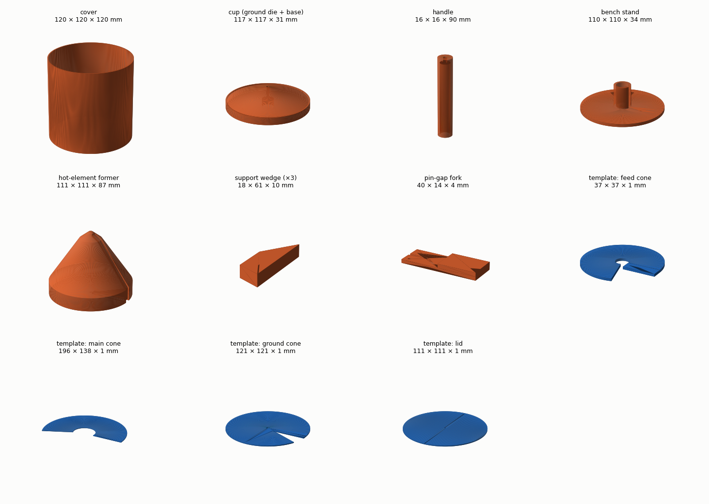
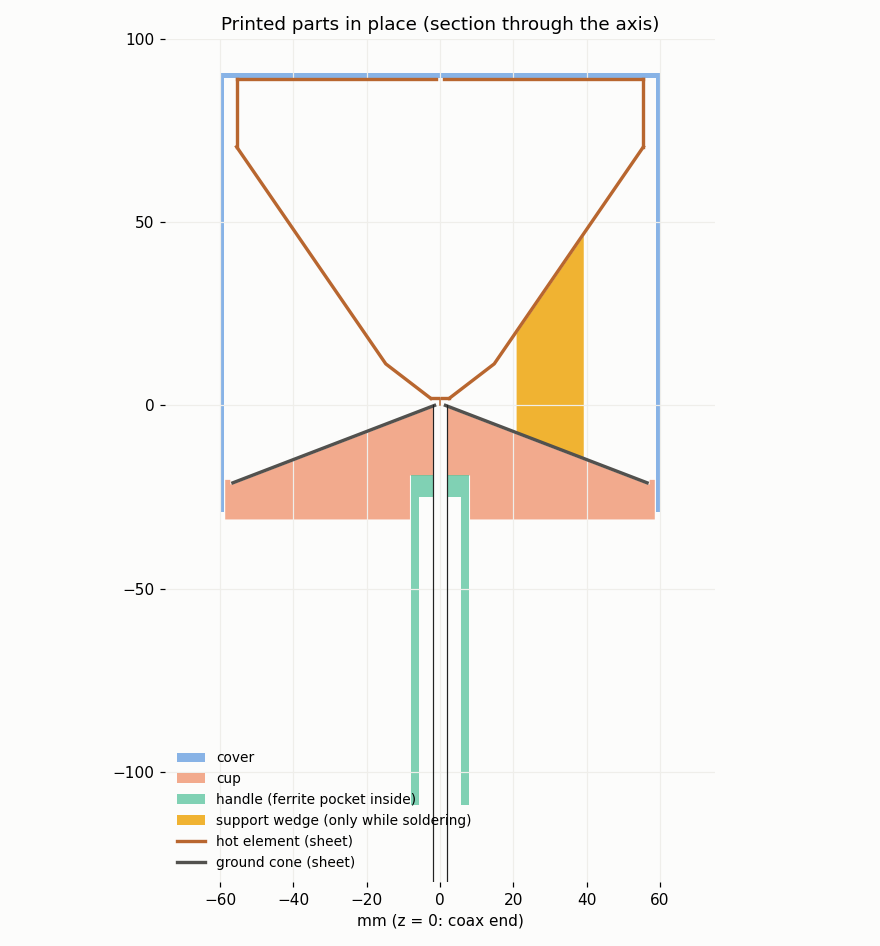

# Building the FPV-detector antenna at home (design B, 800 MHz – 6.4 GHz)

A step-by-step guide to building design B from
[FPV-DETECTOR-ANTENNA.md](FPV-DETECTOR-ANTENNA.md) with hand tools, a soldering iron and a 3D printer.
The printed parts are:

- **Templates** to cut the sheet.
- **Formers** to roll the cones.
- **Jigs** to hold everything in place while you solder.
- **A cover and a cup** that hold and protect the finished antenna.

Nothing here needs a lathe or a press.

Plan for about one afternoon of printing and 2–3 hours of metal work. The antenna weighs about 75 g,
plus about 150 g of printed parts.





STL files: [`fpv-detector/print/`](fpv-detector/print/) (millimetres, already oriented for printing).
To make them for a changed design, run `tools/wideband-antenna/print_parts.py`
(see [Re-generating the parts](#re-generating-the-parts)).

## 1. What you need

**Metal and electronics**

| Item | Amount | Notes |
|---|---|---|
| Brass or copper sheet, 0.2–0.3 mm | about 300 × 300 mm | Tin-plate from food cans also works and solders very easily. Aluminium does not solder; don't use it. |
| Semi-rigid coax UT-141 / RG-402 (Ø3.58 mm, PTFE), or a "hand-formable .141" jumper with an SMA plug | 15–30 cm | Half of an SMA–SMA .141 jumper is ideal. The other end goes to the detector. |
| Ferrite beads for Ø3.6 mm cable, mix 43 or 61, outer Ø ≤ 11 mm | 1–2 | They go in the handle. A clip-on ferrite on the cable just below the handle also works. |
| Solder (Sn60/Pb40 or Sn63/Pb37, 0.8–1 mm) and rosin flux | | For brass, a stronger flux (zinc-chloride "soldering fluid") makes seams much easier. Wash it off with water afterwards. |
| Glue | | Neutral-cure silicone or two-part epoxy. Cyanoacrylate is fine for tacking. |

**Tools**

| Tool | Used for |
|---|---|
| Soldering iron 60–100 W with a 4–5 mm chisel tip, plus a fine tip (or a second small iron) | Seams, and the pin-to-washer joint |
| Tin snips (straight and curved), a file, fine sandpaper | Cutting the parts |
| Drill bits: Ø1.0 mm and Ø3.6 mm (or a step drill) | The washer hole and the ground apex |
| Scriber or a fine permanent marker, binder clips, a rubber band, kapton or aluminium tape | Marking and holding |
| Calipers | Checking the pin gap and the flush coax end |
| Coax tools: a razor saw or a tube cutter, a craft knife | Cutting the semi-rigid coax |
| VNA or antenna analyser (NanoVNA is fine up to its range) | Checking the result |

## 2. Print the parts

All parts print without supports in the orientation they come in. The settings below assume a
0.4 mm nozzle and a 0.2 mm layer.

| Part | Qty | Material | Settings | Notes |
|---|---|---|---|---|
| `cover.stl` | 1 | **PETG** (or ASA) | 3 walls (= 1.2 mm), 0 % infill, 6 top layers | This is the cover simulated in FDTD (εr 2.6). Keep the wall at 1.2 mm. PLA softens in a hot car. |
| `cup.stl` | 1 | PETG or PLA | 3 walls, 15–20 % infill | The cradle (the conical top) is the **forming die and the seat of the ground cone**. Keep its surface smooth. |
| `handle.stl` | 1 | PETG or PLA | 4 walls, 30 % infill, standing | The narrow end goes up, into the cup. The ferrite pocket (Ø11.2 mm) opens at the bottom. |
| `stand.stl` | 1 | any | 2 walls, 15 % | Holds the handle upright on the bench. The slot lets the cable out. |
| `hot_former.stl` | 1 | PLA or PETG | 2 walls, 10 % infill, flat end down | Mandrel with the inside shape of the hot element: tip = feed cone, body = main cone, cylinder = rim. The 8 mm groove along one side is where the seam goes. |
| `support_wedge.stl` | 3 | any | lying flat | They hold the main cone at the right height while you solder. You remove them before fitting the cover. |
| `gap_fork.stl` | 1 | PLA | **0.1 mm layers**, 100 % infill | Sets the 1.90 mm pin gap. **Measure it.** Sand it if it is over 1.95 mm; shim it with tape if it is under 1.85 mm. |
| `tpl_hot_cone1.stl` (feed cone), `tpl_hot_cone2.stl` (main cone), `tpl_gnd_cone1.stl` (ground cone), `tpl_lid.stl` | 1 each | PLA | 1.2 mm flat, 100 % | Cutting templates. The main-cone template is 196 mm long and needs a 200 mm bed. Otherwise use the paper template from the app (Build → "Build sheet + 1:1 template (PDF)"). |

The rim is a plain strip, **348.7 × 18.5 mm, plus a 5 mm lap**. Mark it with a ruler.

The **washer** is a Ø5.0 mm disc with a Ø1.0 mm centre hole. Drill the hole first in a scrap of
sheet, then cut and file the disc round it.

## 3. Cut the sheet

1. Lay each template on the sheet and scribe round it. The strip beyond the groove line is the **5 mm
   lap** for the seam: cut it on, and keep the groove line marked (it is where the other edge goes).
2. Cut with snips just outside the line, then file to the line. Remove every burr: burrs stop the
   seam closing and the cone ends up the wrong angle.
3. Pre-tin both edges of every seam (lap and the edge that lands on it), and the outer 2 mm of the
   rim strip's long edges. It is much easier now than when the part is rolled.

| Part | Flat pattern (from the templates) | Formed |
|---|---|---|
| Feed cone | sector R 3.2 – 18.7 mm, 285.6° | 52.5° cone, Ø5 → Ø29.6 mm, 9.4 mm tall |
| Main cone | sector R 26.1 – 98.0 mm, 203.9° | 34.5° cone, Ø29.6 → Ø111 mm, 59.2 mm tall |
| Rim | strip 348.7 × 18.5 mm | cylinder Ø111 × 18.5 mm |
| Lid | disc Ø111 mm (a Ø2 mm centre hole is fine) | flat |
| Washer | disc Ø5.0 mm, hole Ø1.0 mm | flat |
| Ground cone | sector R 1.6 – 60.5 mm, 336.1° | 69° cone, Ø113 mm, 21.1 mm deep |

## 4. Form and solder the parts

The formers are plastic. **Never hold the iron on plastic.** Each former has a place where the seam
can be soldered clear of it, and the steps below use that place.

1. **Ground cone.**
   - Close the 24° gap of the ground sector until its edge lands on the lap line. It becomes a very
     shallow cone.
   - Press it into the cup's cradle. When the angle is right, it sits flat all the way round.
   - Clip the lap with two binder clips. Lift the cone out and solder the seam on a heat-proof mat.
   - Ream the apex hole to **Ø3.6 mm** so the coax jacket is a snug push fit.
2. **Feed cone.**
   - Wrap the small sector round the tip of the hot former, with the seam **over the groove**. Hold it
     with a rubber band.
   - Tack the seam at both ends, take the cone off, then solder the full seam.
3. **Washer into the feed cone.**
   - Drop the washer into the small end of the feed cone so that it closes the tip.
   - Solder all round from **inside** the cone. It is shallow, so this is easy.
   - Check that the washer hole is still clear.
4. **Main cone.**
   - Wrap the big sector round the main section of the former, seam over the groove. Hold it with two
     rubber bands.
   - Tack the seam, slide the cone off, then solder the full seam.
5. **Rim.**
   - Roll the strip round the cylinder at the base of the former. Lap it over the groove, clamp it and
     solder the seam.
   - Then put the main cone back on the former, sit the rim on its wide end, and solder the joint all
     round from outside. The former keeps both round and coaxial.
   - Main cone and rim are now one part. **Leave the lid off for now.**

## 5. Assemble on the stand

1. **Coax.**
   - Slide the ferrite bead(s) onto the coax from the cut end.
   - Thread the cut end up through the handle from the bottom, then through the cup.
   - Push the handle into the cup's socket, but don't glue it yet. Stand it in the bench stand, cable
     out through the slot.
2. **Coax end.**
   - Cut the outer conductor and PTFE **flush and square** about 20 mm above the cup. Leave **6 mm**
     of bare centre conductor.
   - With semi-rigid coax: score the jacket all round with a tube cutter or razor saw, then pull the
     jacket and PTFE off together.
3. **Ground cone on the coax.**
   - Slide the ground cone down the coax, but hold it about 10 mm **above** the cup. You want to
     solder it away from the plastic.
   - Set the coax so its cut end is **exactly flush** with the inside surface of the cone apex. Check
     with calipers across the apex.
   - Solder the jacket into the apex all round: hot iron, flux, quick.
   - Let it cool, then lower the ground cone into the cradle. Glue it in with 3–4 dots of silicone and
     glue the handle into the cup.
4. **Washer and feed cone on the pin.**
   - Slide the **gap fork** onto the coax end, with the pin in its slot and the fork flat on the coax
     end.
   - Put the feed cone (washer down) over the pin, so the washer rests on the fork. Look from two
     sides 90° apart and make the cone vertical.
   - Solder the pin to the washer from **above, inside the feed cone**, using the fine tip.
   - Let it cool and slide the fork out sideways.
   - Check the gap: **1.9 ± 0.1 mm**. Trim the pin flush with the top of the washer.
5. **Main cone and rim.**
   - Stand the 3 **support wedges** on the ground cone at 120°, thick end outward.
   - Lower the main-cone-and-rim part onto them. Its small end should meet the feed cone's wide end
     all round, with no step. If needed, slide the wedges in or out a little to centre it.
   - Solder the joint all round from **inside**, through the open top. A normal iron reaches easily.
6. **Lid.**
   - Put the lid on top of the rim and solder it all round from outside.
   - An open lid is noticeably worse at the bottom of the band. The simulated design has it closed.

## 6. Check it, then fit the cover

1. **Measure.**
   - Calibrate the VNA at the SMA end of the coax and sweep 0.7–6.5 GHz.
   - Expect S11 below about −13 dB over most of the band and below −10 dB (SWR 2) everywhere from
     800 MHz to 6.4 GHz.
   - Compare with the model: open "Sky-tilted capped bicone (8:1)" in the app and load your `.s1p` in
     its Simulation tab (the model sweep is `tools/wideband-antenna/results/B_simple.s1p`).
2. **If something is off:**

   | Symptom | Likely cause and fix |
   |---|---|
   | Bad at 4–6.4 GHz | The pin gap (−0.5 mm took the top-band SWR from 1.36 to 1.11), a washer off-centre, or a coax end that is not flush. |
   | Bad near 800 MHz | A joint not soldered all round (lid, rim, cone joint), or the main cone angle. |
   | Changes when you touch the cable | The ferrite is missing or too far down. |

3. **Pull out the 3 wedges** sideways. The hot element now hangs on the pin, so handle it gently
   from here.
4. **Fit the cover.**
   - Put 4–5 dots of silicone or epoxy on the lid.
   - Lower the cover until its inside top **rests on the lid**: the hot element stays at the height
     the pin holds it.
   - Glue or tape the cover's lower edge to the cup wall (8 mm overlap).
   - Let it cure on the stand. From then on, the cover and cup carry the hot element and the pin only
     makes the contact.
5. **Measure again with the cover on.** FDTD says the SWR changes by at most about 0.15 (see below).
6. Fix the ferrite in the handle pocket with a drop of silicone at the bottom.

## Is the plastic a problem?

The cover was checked with the independent FDTD solver. In that check the cover was a 1.2 mm PETG
cylinder Ø117 mm from the ground rim to the lid, with a 1.2 mm top resting on the lid, and 15 cm of
cable. It changed the worst SWR from 1.71 to 1.72, and the patterns by at most 1.1 dB.

The printed cover, the **cup as solid PETG** (worst case: the real part has 15–20 % infill) and the
handle were then checked together, also with 15 cm of cable
(`tools/wideband-antenna/designs/B_cover_cup_shells.json`, `results/fdtd_B_simple_cover_cup_cable15cm.txt`):

| | Bare | Cover only | Cover + cup + handle |
|---|---|---|---|
| Worst SWR, 800 MHz – 6.4 GHz (FDTD) | 1.71 | 1.72 | **1.61** |
| Largest change | — | 3.7–4.2 GHz: 1.28 → 1.43 | 6.4 GHz: 1.38 → 1.50 |
| Gain change at 0–50° elevation (0.9 / 1.25 / 2.44 / 3.3 / 5.8 GHz) | — | ≤ 1.1 dB | ≤ 1.1 dB |

The cup sits under the ground cone, where the fields are weak, and it slightly helps at the bottom of
the band.

Keep any other plastic out of the feed region: the first ~15 mm round the coax end, between the two
cones. A plastic plug there was not simulated, and the pin gap is the most sensitive dimension of the
antenna. The support wedges sit there only while you solder.

## Re-generating the parts

```bash
cd tools/wideband-antenna
python print_parts.py family6 designs/B_simple.json out/      # STL + assembly.png + parts.json
python render_parts.py out/ out/parts.png                     # overview picture
```

`print_parts.py` reads the design's profile:

- the cover, cup cradle, former and wedges follow the cones;
- the fork follows the pin gap;
- the templates are the flat patterns.

An optional fourth argument sets the sheet thickness (default 0.3 mm). Design A (Ø275 mm) is too
large for most printers: build it on rigid foam, with the paper templates from the app.
